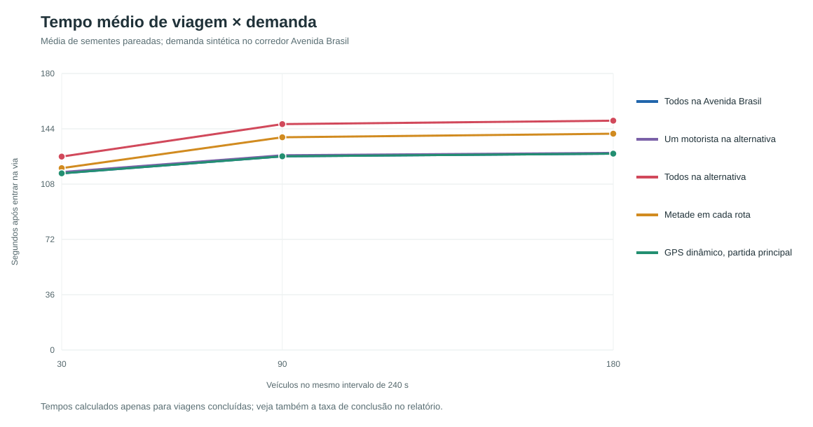
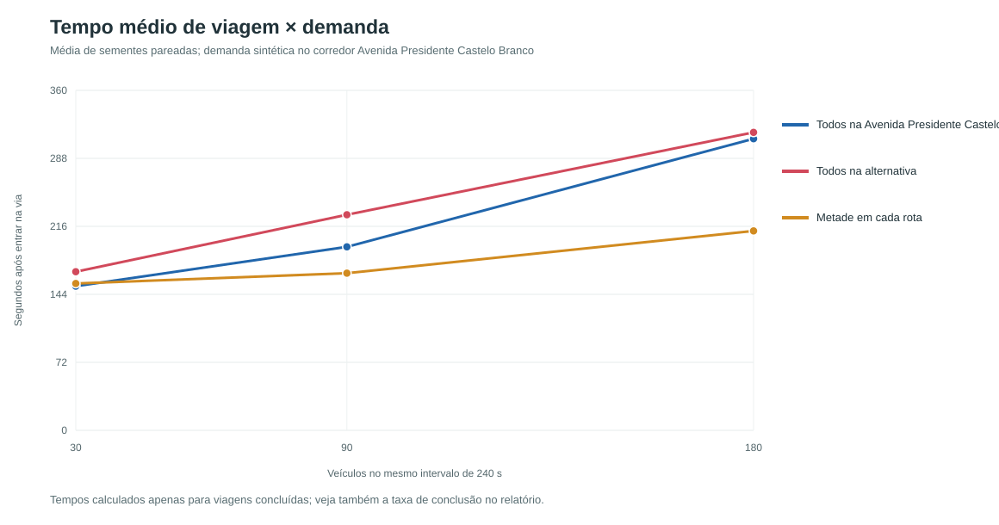
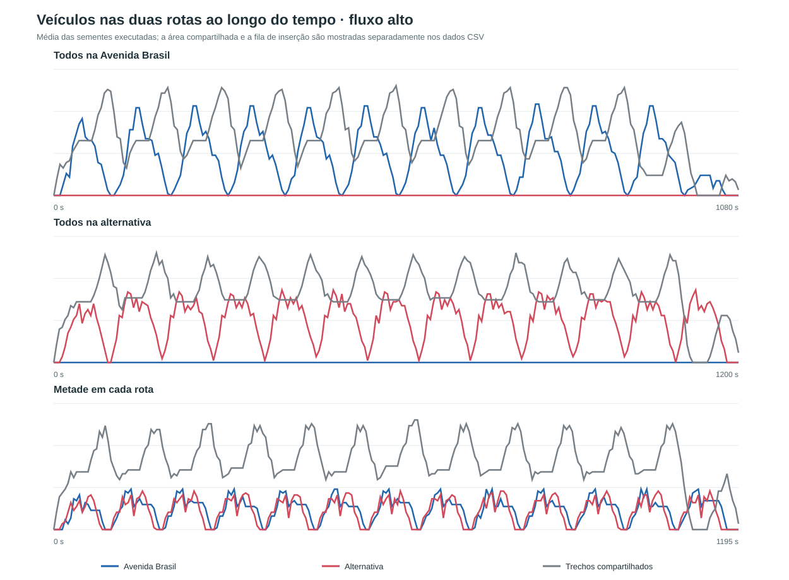
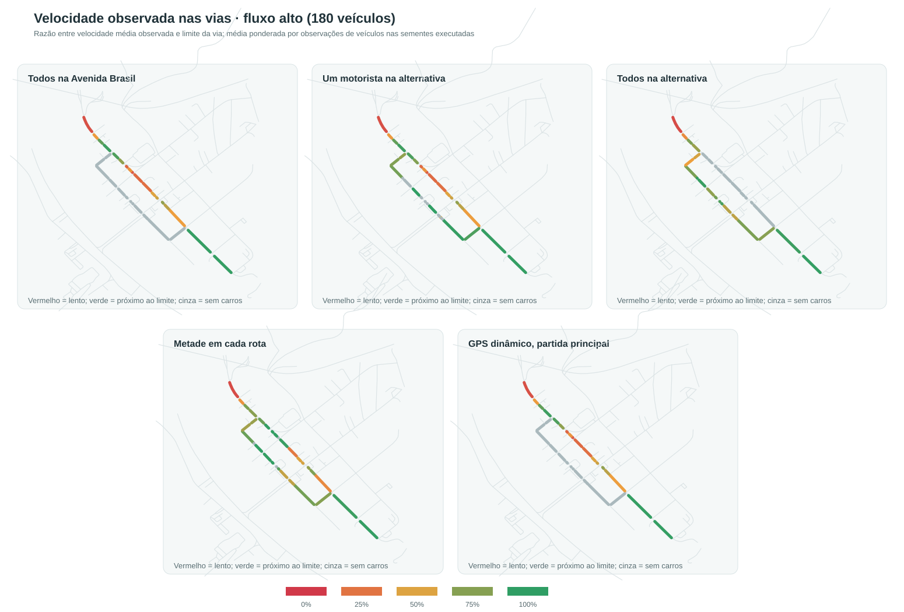
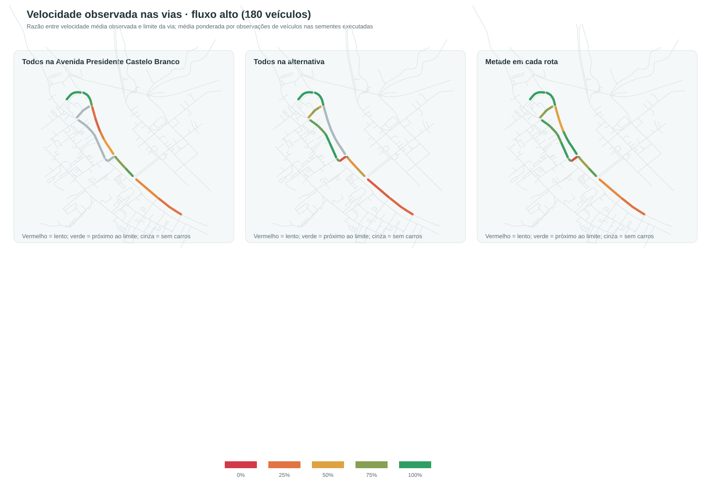

# BLU-ROTAS — efeito da recomendação coletiva de rotas

**Estudo de simulação concluído em 15/11/2026.** Foram realizadas 72 execuções independentes do SUMO, com **7.200 viagens solicitadas e 7.200 concluídas**, em dois corredores do recorte central de Blumenau. Os arquivos nativos de cada viagem, os dados por via e os scripts de reprodução acompanham este relatório.

## Texto para o resumo acadêmico

**Resultados:** Foram comparadas três sementes e três níveis de demanda (30, 90 e 180 veículos em 240 segundos) em dois corredores. Na Avenida Brasil, com 180 veículos, o tempo médio de viagem após a entrada na via foi 127,81 s quando todos seguiram a avenida, 140,81 s com metade em cada caminho e 149,29 s quando todos seguiram a alternativa. Encaminhar apenas o motorista focal ao desvio reduziu o tempo dele de 94,92 para 84,58 s, mas não reduziu a média coletiva (127,81 para 128,34 s). Na Avenida Presidente Castelo Branco, a distribuição entre os dois caminhos reduziu a média de 194,30 para 166,38 s com 90 veículos e de 308,82 para 211,16 s com 180; neste último nível, o percentil 95 caiu de 553,20 para 271,08 s. O GPS dinâmico testado na Avenida Brasil alterou planos de rota, mas não alterou os tempos físicos medidos em comparação com a rota principal fixa.

**Conclusão:** Distribuir motoristas entre rotas pode reduzir o congestionamento coletivo em determinados corredores e níveis de demanda, mas não é uma regra universal: na Avenida Brasil, a alternativa mais longa aumentou o tempo médio e a espera para entrar na rede. Uma recomendação vantajosa para um motorista também pode não beneficiar o conjunto. Os resultados são de cenários sintéticos no recorte viário modelado e não medem o trânsito real de Blumenau. Novos testes devem variar origens e destinos, calibrar a demanda com contagens observadas e ampliar as repetições.

## Método e controle experimental

O estudo usa o **mesmo `Simulator`/TraCI e a mesma rede SUMO do jogo**, em modo sem renderização. A física avança em passos de 0,25 s. Todos os grupos de uma comparação compartilham rede, horários planejados de partida, origens, destinos e semente. As três sementes são `20261114`, `20261115` e `20261116`. As demandas de 30 e 90 veículos são subconjuntos determinísticos da de 180; todas ocorrem dentro de 240 s. Cada execução prossegue até todos chegarem ou até 1.800 s. Não houve obras, alteração de semáforos ou chuva; o teletransporte foi desativado. As vias foram amostradas a cada 5 s.

Os dois pares de arestas e as opções dirigíveis foram calculados pelo roteador do projeto antes das partidas:

| Corredor | Origem → destino SUMO | Rota principal livre | Alternativa livre |
|---|---|---:|---:|
| Avenida Brasil | `1560016695` → `93392451#3` | 39,3 s | 53,4 s, pelas ruas Peru, Uruguai e Chile |
| Avenida Presidente Castelo Branco | `1151559472#0` → `284625097#1` | 73,0 s | 79,6 s, pelas ruas Professor José Ferreira da Silva, XV de Novembro e Padre Roberto Landell de Moura |

Esses tempos são estimativas do grafo sem os congestionamentos simulados; as tabelas abaixo usam os tempos efetivos do SUMO. Em ambos os corredores, o desvio é uma opção **mais lenta em condições livres**. As estratégias foram: todos na principal, somente um motorista focal no desvio, todos no desvio, metade em cada caminho e GPS dinâmico. As duas últimas estratégias extras de motorista focal e GPS foram executadas na Avenida Brasil; o segundo corredor foi usado como teste de sensibilidade das três políticas coletivas centrais. O GPS dinâmico iniciou na principal e avaliou troca a cada 15 s, exigindo 5% de economia prevista.

## Tempo médio × demanda

**Avenida Brasil — média das três sementes, em segundos.** “Viagem” começa quando o carro entra fisicamente na via. “Total” começa na partida planejada e inclui a espera para inserção. Todos os 4.500 carros deste corredor concluíram.

| Estratégia | Viagem, 30 | Viagem, 90 | Viagem, 180 | Total, 180 | P95 viagem, 180 | Tempo perdido, 180 |
|---|---:|---:|---:|---:|---:|---:|
| Todos na avenida | 115,00 | 126,08 | **127,81** | **443,62** | **155,08** | 75,93 |
| Só um motorista no desvio | 115,85 | 126,79 | 128,34 | 444,64 | 155,50 | 76,35 |
| Todos no desvio | 125,90 | 147,06 | 149,29 | 531,50 | 170,17 | 78,30 |
| Metade em cada rota | 118,38 | 138,49 | 140,81 | 524,00 | 170,35 | 79,40 |
| GPS dinâmico, partida principal | 115,00 | 126,08 | 127,81 | 443,62 | 155,08 | 75,93 |

**Avenida Presidente Castelo Branco — média das três sementes, em segundos.** Todos os 2.700 carros deste corredor concluíram.

| Estratégia | Viagem, 30 | Viagem, 90 | Viagem, 180 | Total, 180 | P95 viagem, 180 | Tempo perdido, 180 |
|---|---:|---:|---:|---:|---:|---:|
| Todos na avenida | 152,65 | 194,30 | 308,82 | 326,90 | 553,20 | 223,21 |
| Todos no desvio | 167,93 | 228,27 | 315,52 | 389,82 | 494,88 | 214,22 |
| Metade em cada rota | 155,52 | **166,38** | **211,16** | **229,29** | **271,08** | **117,70** |

Na Avenida Brasil, dividir a demanda alta elevou a média de viagem em **13,00 s (10,2%)** e o tempo total em **80,38 s (18,1%)**. Na Castelo Branco, a mesma distribuição reduziu a média de viagem em **97,66 s (31,6%)** e o tempo total em **97,61 s (29,9%)**. Mandar todos pelo desvio na Castelo Branco não foi equivalente a distribuir: em fluxo alto, o tempo total foi 389,82 s, acima dos 326,90 s da principal.

Gráficos complementares: [tempo total × demanda, Brasil](estudo-rotas-coletivas/tempo-total-demanda.svg), [tempo total × demanda, Castelo Branco](estudo-castelo-branco/tempo-total-demanda.svg), [tempo perdido × demanda, Brasil](estudo-rotas-coletivas/tempo-perdido-demanda.svg) e [tempo perdido × demanda, Castelo Branco](estudo-castelo-branco/tempo-perdido-demanda.svg).

## Comparação pareada e incerteza

Diferença = estratégia menos “todos na principal”, para a **média de viagem** da mesma semente. Um valor negativo indica menos tempo. O intervalo de 95% foi calculado com t de Student sobre apenas três diferenças pareadas; serve como descrição exploratória, sem validar o trânsito real.

| Corredor | Demanda | Estratégia | Diferença média | Intervalo de 95% |
|---|---:|---|---:|---:|
| Brasil | 30 | Um motorista no desvio | +0,85 s | −0,06 a +1,76 s |
| Brasil | 30 | Todos no desvio | +10,90 s | +9,04 a +12,76 s |
| Brasil | 30 | Metade em cada rota | +3,38 s | +2,41 a +4,35 s |
| Brasil | 90 | Um motorista no desvio | +0,71 s | −0,65 a +2,07 s |
| Brasil | 90 | Todos no desvio | +20,97 s | +19,09 a +22,86 s |
| Brasil | 90 | Metade em cada rota | +12,41 s | +11,23 a +13,59 s |
| Brasil | 180 | Um motorista no desvio | +0,53 s | −0,62 a +1,68 s |
| Brasil | 180 | Todos no desvio | +21,47 s | +19,10 a +23,85 s |
| Brasil | 180 | Metade em cada rota | +13,00 s | +10,44 a +15,56 s |
| Castelo Branco | 30 | Todos no desvio | +15,27 s | +15,16 a +15,39 s |
| Castelo Branco | 30 | Metade em cada rota | +2,86 s | +2,55 a +3,18 s |
| Castelo Branco | 90 | Todos no desvio | +33,97 s | +27,63 a +40,31 s |
| Castelo Branco | 90 | Metade em cada rota | −27,92 s | −34,01 a −21,84 s |
| Castelo Branco | 180 | Todos no desvio | +6,69 s | −31,11 a +44,50 s |
| Castelo Branco | 180 | Metade em cada rota | **−97,66 s** | **−130,93 a −64,40 s** |

O GPS dinâmico apresentou diferença de **0,00 s** nos três níveis da Avenida Brasil. Nas nove comparações pareadas, os sete campos físicos de viagem de cada um dos **900 veículos** coincidiram exatamente com a política fixa da principal, embora 465 veículos tivessem ao menos uma mudança de **plano** de rota. Isso mostra que contar recálculos não prova que um desvio foi percorrido. A configuração e o ponto de decisão do GPS devem ser estudados separadamente antes de atribuir benefício ao algoritmo.

## Motorista focal, filas e vias

Na Avenida Brasil com 180 veículos, o motorista focal levou em média **94,92 s** pela principal e **84,58 s** quando foi o único enviado ao desvio: ganho individual de **10,33 s**, acompanhado de mudança coletiva média de **+0,53 s**. Na Castelo Branco, a divisão reduziu a média coletiva alta, mas o motorista focal, colocado na alternativa, passou de **208,33 para 227,58 s**. A política coletiva pode beneficiar a rede sem beneficiar todo indivíduo.

Em demanda alta, os picos médios por execução nas arestas exclusivas das rotas foram:

| Corredor e estratégia | Fila na principal | Fila no desvio | Carros esperando inserção | Atraso médio de inserção |
|---|---:|---:|---:|---:|
| Brasil, todos na principal | 17,00 | 0 | 123,67 | 315,94 s |
| Brasil, todos no desvio | 0 | 2,00 | 129,67 | 382,34 s |
| Brasil, metade em cada | 5,00 | 2,00 | 129,67 | 383,31 s |
| Castelo Branco, todos na principal | 44,00 | 0 | 30,67 | 18,20 s |
| Castelo Branco, todos no desvio | 0 | 11,00 | 63,67 | 74,43 s |
| Castelo Branco, metade em cada | 21,33 | 10,33 | 30,67 | 18,26 s |

As velocidades médias nas **arestas exclusivas**, ponderadas pela quantidade de observações de veículos nas três sementes de fluxo alto, ajudam a interpretar o calor do mapa:

| Corredor e estratégia | Principal | Desvio |
|---|---:|---:|
| Brasil, todos na principal | 27,75 km/h | sem veículos |
| Brasil, todos no desvio | sem veículos | 39,09 km/h |
| Brasil, metade em cada | 35,59 km/h | 42,28 km/h |
| Castelo Branco, todos na principal | 12,74 km/h | sem veículos |
| Castelo Branco, todos no desvio | sem veículos | 28,72 km/h |
| Castelo Branco, metade em cada | 29,65 km/h | 27,23 km/h |

Na Avenida Brasil, reduzir a fila **dentro** da via principal não reduziu necessariamente a duração completa da viagem: o desvio é mais longo e o ponto de partida comum se tornou um gargalo de inserção. No corredor Castelo Branco, a divisão reduziu a fila da principal e o tempo de percurso sem ampliar o pico de espera para inserção. As séries de ocupação por rota estão nos CSV e gráficos abaixo. O mapa de calor representa **velocidade simulada observada dividida pelo limite da via**, não velocidades reais medidas em Blumenau; cinza indica ausência de carros observados na aresta.

## Como ler e reproduzir os dados

O indicador `time_loss_s` é o `timeLoss` nativo do SUMO: tempo acumulado abaixo da velocidade ideal ao longo da rota efetivamente percorrida. Ele não é a diferença em relação à melhor estratégia coletiva. `travel_s` começa na entrada física; `door_to_door_s` inclui a espera entre partida planejada e entrada. Os percentis e as médias de duração usam viagens concluídas, e a taxa de conclusão é informada separadamente. Nenhuma viagem foi censurada nestas 72 execuções.

- [Dados agregados da Avenida Brasil](estudo-rotas-coletivas/summary.csv) · [comparações pareadas](estudo-rotas-coletivas/paired_vs_primary.csv) · [cada veículo](estudo-rotas-coletivas/vehicles.csv) · [ocupação temporal](estudo-rotas-coletivas/occupancy.csv) · [cada via](estudo-rotas-coletivas/roads.csv) · [JSON e versão](estudo-rotas-coletivas/summary.json).
- [Dados agregados da Castelo Branco](estudo-castelo-branco/summary.csv) · [comparações pareadas](estudo-castelo-branco/paired_vs_primary.csv) · [cada veículo](estudo-castelo-branco/vehicles.csv) · [ocupação temporal](estudo-castelo-branco/occupancy.csv) · [cada via](estudo-castelo-branco/roads.csv) · [JSON e versão](estudo-castelo-branco/summary.json).
- Em cada pasta `runs/`, os arquivos `*.tripinfo.xml` são saídas nativas do SUMO e os `*.json` preservam parâmetros, métricas e séries de cada repetição. `run_summary.csv` traz as 45 ou 27 execuções separadamente.

**Versões registradas:** SUMO 1.28.0; hash da malha SUMO `633d9a0824eb0bb7`; hash de código do estudo `dbc09dd589269e9f`. O código e os comandos de repetição estão em [protocolo do estudo](../docs/estudo-rotas-coletivas.md), [executor](../scripts/collective_route_study.py), [gerador de gráficos](../scripts/render_collective_study.py) e [validador](../scripts/validate_collective_study.py). Os resultados foram verificados quanto ao pareamento dos horários, atribuição das rotas, total de viagens, saídas TripInfo, contagens CSV e sintaxe dos cinco SVG por corredor. A suíte geral do projeto passou com 20 testes; o frontend compilou.

## Limitações e próximos testes

O modelo usa um recorte OSM central, um único par origem/destino por corredor, demanda sintética e três sementes. As viagens se concentram em uma aresta de entrada, o que pode dominar o tempo de inserção; os sinais e conexões do SUMO representam a malha gerada, sem calibração com contagens reais. Não há base para extrapolar os números ao município inteiro, afirmar que aplicativos reais enviam todos à mesma rota, ou declarar uma política universalmente superior. A repetição em outras origens, destinos, horários, composições de tráfego e redes calibradas é necessária. Intervalos estreitos em algumas linhas refletem pouca variabilidade entre estas três sementes, não certeza sobre condições reais.

Fontes de definição de indicadores: [TripInfo do SUMO](https://sumo.dlr.de/docs/Simulation/Output/TripInfo.html), [valores dos veículos no TraCI](https://sumo.dlr.de/docs/TraCI/Vehicle_Value_Retrieval.html), [valores das vias no TraCI](https://sumo.dlr.de/docs/TraCI/Edge_Value_Retrieval.html).
